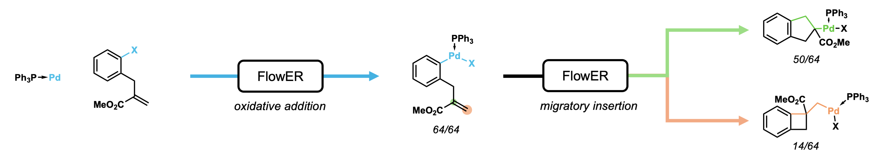

# FlowER-OM: Flow Matching for Electron Redistribution in Organometallic Chemistry
_Eric K. Wu, Nicholas Casetti, Richmond Sarpong, Connor W. Coley_



Repo for "Learning organometallic reactivity with a flow matching model for mechanism prediction". 

FlowER uses flow matching to model chemical reaction as a process of electron redistribution, conceptually
aligns with arrow-pushing formalisms. It aims to capture the probabilistic nature of reactions with mass conservation
where multiple outcomes are reached through branching mechanistic networks evolving in time.

FlowER-OM extends FlowER to predict a broader scope of organometallic chemistry. Key changes include handling of dative bonding.

## Environment Setup
### System requirements
**Ubuntu**: >= 16.04 <br>
**conda**: >= 4.0 <br>
**GPU**: at least 25GB Memory with CUDA >= 12.2

```bash
$ conda create -n flower python=3.10
$ conda activate flower
$ pip install -r requirements.txt
```

## Data/Model preparation
FlowER is trained on a combination of subset of USPTO-FULL (Dai et al.), RmechDB and PmechDB (Baldi et al.) and organometallic reactions derived from Pistachio 2025 Q1 (a commercial dataset from NextMove Software). <br>
To retrain FlowER, download `data.zip` from [the original FlowER dataset](https://figshare.com/articles/dataset/FlowER_-_Mechanistic_datasets_and_model_checkpoint/28359407/3) and remove all steps containing Pd and Cu. Mechanistic steps should be derived from Pistachio using code from [this repo](https://github.com/wuerickai/Mechanistic_dataset) but will require a NextMove license. 


To reproduce experimental results, the trained checkpoint used for experiments in the paper can be downloaded [here](https://doi.org/10.6084/m9.figshare.35013550).

## On how FlowER is structured
The workflow of FlowER revolves mainly around 2 files. `run_FlowER.sh` and `settings.py`. <br> 
The main idea is to use comments `#` to turn on/off configurations when training/validating/inferencing FlowER. <br>
`run_FlowER.sh` allows user to specify your data folder name, experiment name, gpu configuration and choose which scripts to run. <br>
`settings.py` allows user to specify different configurations for different workflows. 

## Training Pipeline
### 1. Train FlowER
Ensure that `data/` folder is populated accordingly and `run_FlowER.sh` is pointing to the correct files.
```
export TRAIN_FILE=$PWD/data/$DATA_NAME/train.txt
export VAL_FILE=$PWD/data/$DATA_NAME/val.txt
```
Check `run_FlowER.sh` has `scripts/train.sh` uncommented. 
```bash
$ sh run_FlowER.sh
```

### 2. Validate FlowER
You can validate FlowER on the validation set. Then, in `settings.py`, ensure these are uncommented.
```
    # validation #
    do_validate = True
    steps2validate =  ["1050000", "1320000", "1500000", "930000", "1020000"]
```
`steps2validate` refers to the checkpoints that are selected based on train logs situated at the `/logs` folder. <br>
Check `run_FlowER.sh` has `scripts/eval.sh` uncommented. 
```bash
$ sh run_FlowER.sh
```


### 3. Test FlowER
You can validate FlowER on the test set. Then, in `settings.py`, specify your checkpoint at `MODEL_NAME` and ensure these are uncommented.
```
    # inference #
    do_validate = False
```
Check `run_FlowER.sh` has `scripts/eval.sh` uncommented. 
```bash
$ sh run_FlowER.sh
```

#### FlowER train/valid/test input
FlowER takes in atom-mapped reaction as input for training, validation and testing. Each of this elementary reaction steps that is trained on FlowER can be grouped together using sequence index during evaluation when running `sequence_evaluation.py`. For any organometallic reactions, ensure that dative bonds have been properly indicated in SMILES.\
\
An elementary reaction step reaction follows the format of `mapped_reaction|sequence_idx`. Examples are as follows:
```
[Cl:1][S:2]([Cl:3])=[O:4].[Cl:5][C:6]1=[N:7][S:8][C:9]([C:10](=[O:11])[O:12][H:15])=[C:13]1[Cl:14]>>[Cl:1][S:2]([Cl:3])([O-:4])[O:11][C:10]([C:9]1=[C:13]([Cl:14])[C:6]([Cl:5])=[N:7][S:8]1)=[O+:12][H:15]|11831
[Cl:1][S:2]([Cl:3])([O-:4])[O:11][C:10]([C:9]1=[C:13]([Cl:14])[C:6]([Cl:5])=[N:7][S:8]1)=[O+:12][H:15]>>[Cl-:1].[S:2]([Cl:3])(=[O:4])[O:11][C:10]([C:9]1=[C:13]([Cl:14])[C:6]([Cl:5])=[N:7][S:8]1)=[O+:12][H:15]|11831
[Cl-:1].[S:2]([Cl:3])(=[O:4])[O:11][C:10]([C:9]1=[C:13]([Cl:14])[C:6]([Cl:5])=[N:7][S:8]1)=[O+:12][H:15]>>[Cl:1][C:10]([C:9]1=[C:13]([Cl:14])[C:6]([Cl:5])=[N:7][S:8]1)([O:11][S:2]([Cl:3])=[O:4])[O:12][H:15]|11831
[Cl:1][C:10]([C:9]1=[C:13]([Cl:14])[C:6]([Cl:5])=[N:7][S:8]1)([O:11][S:2]([Cl:3])=[O:4])[O:12][H:15]>>[Cl-:3].[Cl:1][C:10]([C:9]1=[C:13]([Cl:14])[C:6]([Cl:5])=[N:7][S:8]1)=[O+:12][H:15].[S:2](=[O:4])=[O:11]|11831
[Cl-:3].[Cl:1][C:10]([C:9]1=[C:13]([Cl:14])[C:6]([Cl:5])=[N:7][S:8]1)=[O+:12][H:15].[S:2](=[O:4])=[O:11]>>[Cl:1][C:10]([C:9]1=[C:13]([Cl:14])[C:6]([Cl:5])=[N:7][S:8]1)=[O:12].[Cl:3][H:15].[S:2](=[O:4])=[O:11]|11831
[Cl:1][C:10]([C:9]1=[C:13]([Cl:14])[C:6]([Cl:5])=[N:7][S:8]1)=[O:12].[Cl:3][H:15].[S:2](=[O:4])=[O:11]>>[Cl:1][C:10]([C:9]1=[C:13]([Cl:14])[C:6]([Cl:5])=[N:7][S:8]1)=[O:12].[Cl:3][H:15].[S:2](=[O:4])=[O:11]|11831
```

<details><summary><b>Train/Valid/Test hyperparameters</b></summary>

### Model Architecture
- **`emb_dim`**  - Embedding dimension size of atom embeddings
- **`enc_num_layers`** - Number of transformer layers to be applied
- **`enc_heads`** - Number of attention heads
- **`enc_filter_size`** - Dimension of Feed-Forward Network in Transformer block
- **`(attn)_dropout`** - Dropout for Transformer block (0.0 empirically works well)
- **`sigma`** - Standard deviation of Gaussian noise added for reparameterizing the bond-electron (BE) matrix

### Optimization
- **`lr`** - Learning rate for training (NoamLR)
- **`warmup`** - Warmup steps before LR decay (NoamLR)
- **`clip_norm`** - Gradient clipping threshold to prevent exploding gradients
- **`beta1`**, **`beta2`**  -  Adam optimizer’s momentum terms
- **`eps`** -  Adam optimizer’s denominator term for numerical stability
- **`weight_decay`** - L2 regularization strength to prevent overfitting

### Input representation (Bond-Electron matrix)
- **`rbf_low`** - Radial Basis Function (RBF) centers lowest value
- **`rbf_high`** - Radial Basis Function (RBF) centers highest value
- **`rbf_gap`** - Glanularity of RBF centers increment

### Inference 
- **`do_validate`** - True to trigger validation, False to trigger testing
- **`steps2validate`** - List of checkpoints to run FlowER on for validation
- **`validation_top1`** - When enabled with `VALIDATION_TOP1=1`, validation also reports
  accuracy for the most frequent predicted product (top-1) alongside top-k accuracy
- **`sample_size`** - Number of samples FlowER generates for evaluation

</details>

### 4. Use FlowER for search
FlowER mainly uses beam search to seek for plausible mechanistic pathways. Users can input their smiles at `data/flower_dataset/beam.txt`. <br>
Ensure that in `run_FlowER.sh`, the `TEST_FILE` variable is pointing towards the correct file.
```
export TEST_FILE=$PWD/data/$DATA_NAME/beam.txt
```
Ensure that in `settings.py`, beam search configuration are uncommented and specified accordingly.
```
    test_path = f"data/{DATA_NAME}/beam.txt"

    # beam-search #
    beam_size = 5
    nbest = 3
    max_depth = 15
    chunk_size = 50
```
Check `run_FlowER.sh` has `sh scripts/search_multiGPU.sh` uncommented. 
```bash
$ sh run_FlowER.sh
```
Visualize your route at `examples/vis.ipynb` (The fine-tuned beam search result for the cascade in the paper is the provided example.)

#### FlowER search input
FlowER takes in a non atom-mapped reaction for beam search which can be specified in `beam.txt`
The format of reactants in the file follows `reactant>>product1|product2|...`, where we can specify multiple major and minor products separated by `|` in the file
```
CC(=O)CC(=O)C(F)(F)F.NNc1cccc(Br)c1>>Cc1cc(C(F)(F)F)n(-c2cccc(Br)c2)n1
CC(=O)CC(=O)C(F)(F)F.NNc1cccc(Br)c1>>Cc1cc(C(F)(F)F)n(-c2cccc(Br)c2)n1|Cc1cc(C(F)(F)F)nn1-c1cccc(Br)c1
```

<details><summary><b>Search hyperparameters</b></summary>

- **`beam_size`** - Size of top-k selection of candidates (based on cumulative probability)
to be further expanded. Increasing this would make the overall search more comprehensive, but at the
cost of slower runtime.
- **`nbest`** - Cut-off size of the top-k outcomes generated by FlowER after the expan-
sion. This cutoff can filter out unlikely outcomes to be part of the selection.
- **`sample_size`** - Number of samples FlowER generates for evaluation
- **`max_depth`** - Refers to the maximum depth the beam search should explore.
- **`chunk_size`** - Number of reactants sets to be run beam search concurrently.

</details>

## Details on differences between FlowER-OM and FlowER

**Bond dativization.** FlowER-OM supports donor-to-metal dative bonds (`donor->metal` in SMILES) to represent coordination without introducing inappropriate donor valences. The bond-electron (BE) matrix allows for both bonding electrons to originate from the donor while retaining a symmetric matrix representation. Donor information is retained when converting predicted matrices back to molecular structures, and sanitization converts suitable metal–ligand bonds to dative bonds to resolve valence errors. Training, validation, and test inputs need to specify appropriate dative bonds.

**Optional features outside the final publication.** The repository also retains two experimental options in `settings.py`, both disabled by default and neither used in the final publication. These features were found to not signficantly improve the performance of the model:

- **Delta BE (`pred_del_BE = True`):** Models the change in the BE matrix, `BE_product - BE_reactant`, conditioned on the reactant matrix. Instead of flowing from a reactant matrix to a product matrix, the model is trained to flow from a noised zero matrix to a delta BE matrix, which is then added to the reactant matrix to arrive at a product matrix. 
- **Oxidation states (`oxd_states = True`):** Adds per-atom oxidation-state features, calculated from the BE matrix using electronegativity-based electron assignment and formal charges, to the model's representation through an additional radial basis function embedding.

## Citation
```bibtex
Coming soon!
```
